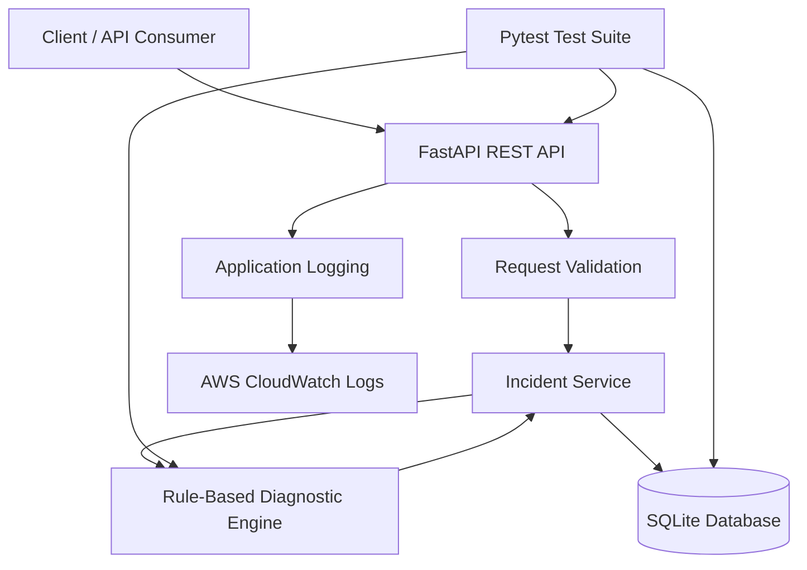
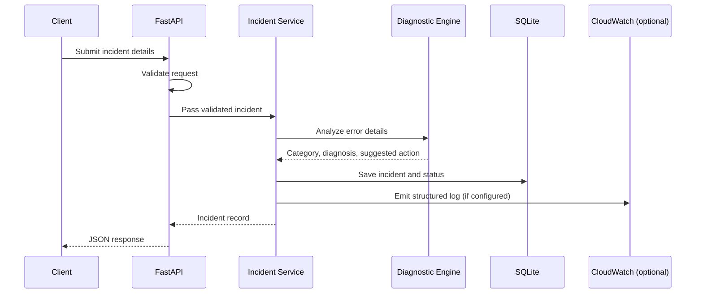

# API Troubleshooting & Incident Management System

> **Project documentation template**  
> Stack described for this project: Python, FastAPI, REST API, SQLite, AWS CloudWatch, and Pytest.  
> This ZIP contains documentation and architecture/workflow diagrams, not a complete runnable application. Adjust endpoint names, schemas, and implementation details to match your actual source code before publishing.

## 1. Project Overview

The API Troubleshooting & Incident Management System is intended to help monitor API failures, record incidents, classify common errors, and suggest corrective actions. FastAPI exposes REST endpoints, SQLite stores incident records, rule-based diagnostics analyze known error patterns, Pytest validates expected behavior, and AWS CloudWatch can be used to collect and inspect application logs.

### Goals

- Record and track API incidents.
- Classify common failures using configurable diagnostic rules.
- Provide suggested next steps for known error scenarios.
- Expose incident information through REST endpoints.
- Support troubleshooting through application logs and CloudWatch.
- Test diagnostic rules and API behavior with Pytest.

## 2. Technology Stack

| Technology | Purpose |
|---|---|
| Python | Core application and diagnostic logic |
| FastAPI | REST API framework and request validation |
| SQLite | Lightweight persistent storage for incident records |
| AWS CloudWatch | Centralized log collection, searching, and monitoring when configured |
| Pytest | Automated tests for API routes and diagnostic rules |

## 3. Architecture



### Component responsibilities

1. **Client / API consumer** — submits incident details or requests incident records.
2. **FastAPI REST API** — receives HTTP requests, validates input, and returns JSON responses.
3. **Request validation** — rejects malformed or incomplete requests with suitable HTTP errors.
4. **Incident service** — coordinates incident creation, updates, retrieval, and status changes.
5. **Rule-based diagnostic engine** — matches error codes, messages, or failure categories to diagnostic rules and suggested actions.
6. **SQLite database** — stores incident metadata and current status.
7. **Application logging** — emits useful operational events and error details without exposing secrets.
8. **AWS CloudWatch Logs** — receives logs if the application and AWS permissions/logging configuration are set up.
9. **Pytest** — tests routes, diagnostic rules, and data-handling behavior.

## 4. Data Model (Suggested)

A minimal `incidents` table could contain the following fields. Align these names and types with your actual schema.

| Field | Suggested type | Description |
|---|---|---|
| `id` | INTEGER PRIMARY KEY | Unique incident identifier |
| `title` | TEXT | Short incident summary |
| `error_code` | TEXT | HTTP or application error code, if known |
| `error_message` | TEXT | Sanitized error summary |
| `severity` | TEXT | For example: low, medium, high, critical |
| `category` | TEXT | Rule-derived incident category |
| `diagnosis` | TEXT | Explanation of the matched rule |
| `suggested_action` | TEXT | Troubleshooting recommendation |
| `status` | TEXT | For example: open, investigating, resolved |
| `created_at` | TEXT | Creation timestamp |
| `updated_at` | TEXT | Last update timestamp |

**Important:** Do not store credentials, access tokens, personal data, or full request bodies by default. Sanitize logs and incident messages.

## 5. End-to-End Workflow



### Step-by-step

1. **Receive an event:** A client or a developer submits incident details, such as an error code, message, endpoint, and timestamp.
2. **Validate input:** FastAPI validates required fields and data types. Invalid input should return a clear 4xx response.
3. **Normalize the error:** Convert known error details into a consistent format before applying diagnostic rules.
4. **Run diagnostics:** Evaluate the error against the configured rule set.
5. **Classify the incident:** Assign a category/severity where a rule supports it.
6. **Suggest an action:** Return a relevant troubleshooting hint, such as checking authentication configuration for a 401/403 response or verifying upstream availability for a 502/503 response.
7. **Persist the record:** Save the incident, diagnosis, suggested action, and initial status to SQLite.
8. **Log the event:** Write structured application logs. If AWS CloudWatch is configured, route logs to a log group/stream using the chosen logging agent or AWS integration.
9. **Return the result:** Send a JSON response containing the incident ID and recorded diagnostic result.
10. **Track resolution:** Retrieve an incident and update its status as investigation progresses.
11. **Test and verify:** Run Pytest to check validation, rule matching, persistence, status updates, and error paths.

## 6. Suggested Diagnostic Rules (6+ scenarios)

The project description mentions rule-based diagnostics for 6+ error scenarios. The following is a suggested rule catalogue; only claim the rules you have actually implemented.

| Scenario | Possible interpretation | Suggested checks |
|---|---|---|
| HTTP 400 — Bad Request | Invalid or malformed input | Check required fields, data types, and request format |
| HTTP 401 — Unauthorized | Missing or invalid authentication | Check token presence, expiry, and authentication configuration |
| HTTP 403 — Forbidden | Authenticated caller lacks permission | Check roles, permissions, and access policy |
| HTTP 404 — Not Found | Resource or route does not exist | Check URL, resource identifier, and route registration |
| HTTP 429 — Too Many Requests | Rate limit reached | Check request frequency and configured throttling limits |
| HTTP 500 — Internal Server Error | Unhandled application failure | Inspect sanitized traceback and application logs |
| HTTP 502 — Bad Gateway | Invalid response from upstream | Check upstream service health and proxy/gateway settings |
| HTTP 503 — Service Unavailable | Service is temporarily unavailable | Check service health, capacity, and dependency availability |
| HTTP 504 — Gateway Timeout | Upstream response timed out | Check latency, timeout settings, and dependency health |

Rule matches should be deterministic and explainable. If no rule matches, return a safe “unknown/unclassified” diagnosis rather than inventing a cause.

## 7. Suggested REST API Contract

The paths below are examples, not verified endpoints from your code. Rename them to match the implementation.

| Method | Example path | Purpose |
|---|---|---|
| `POST` | `/incidents` | Create/analyze an incident |
| `GET` | `/incidents` | List incidents, optionally filtered by status |
| `GET` | `/incidents/{incident_id}` | Retrieve one incident |
| `PATCH` | `/incidents/{incident_id}/status` | Update incident status |
| `GET` | `/health` | Basic service health check |

### Example request

```json
{
  "title": "Payment API returned an error",
  "error_code": "503",
  "error_message": "Upstream service unavailable",
  "endpoint": "/api/payments"
}
```

### Example response (illustrative only)

```json
{
  "id": 12,
  "title": "Payment API returned an error",
  "error_code": "503",
  "category": "service_unavailable",
  "diagnosis": "The service may be temporarily unavailable.",
  "suggested_action": "Check service health, capacity, and dependency availability.",
  "status": "open"
}
```

## 8. Local Setup (Adapt to Your Repository)

The README is documentation-only, so the commands below describe a typical FastAPI setup. They will work only after matching application files and dependencies exist.

### Prerequisites

- Python 3.10+ (use the version required by your project)
- `pip`
- Git (optional)
- AWS account and AWS CLI/agent only if you are configuring CloudWatch integration

### Create and activate a virtual environment

**Windows PowerShell**
```powershell
python -m venv .venv
.\.venv\Scripts\Activate.ps1
```

**macOS / Linux**
```bash
python3 -m venv .venv
source .venv/bin/activate
```

### Install dependencies

If your repository has a `requirements.txt`:
```bash
pip install -r requirements.txt
```

Typical packages may include:
```bash
pip install fastapi uvicorn sqlalchemy pytest httpx
```

Install only packages used by your actual implementation. SQLite support is included with Python; a separate database server is not required.

### Run the API

Replace `app.main:app` with the import path used in your project:
```bash
uvicorn app.main:app --reload
```

Then open the FastAPI interactive documentation at:
- `http://127.0.0.1:8000/docs`
- `http://127.0.0.1:8000/redoc`

### Run tests

```bash
pytest -v
```

## 9. AWS CloudWatch Integration Notes

CloudWatch integration depends on how the application is deployed. Merely using AWS CloudWatch as a project keyword does not mean logs are being sent there.

1. Choose the deployment/logging approach (for example, CloudWatch agent on a host, container log driver, or application logging integration).
2. Configure the application to emit structured logs to standard output or a file supported by the chosen collection method.
3. Create or configure a CloudWatch Logs log group and stream through your deployment process or logging agent.
4. Assign least-privilege AWS permissions to the runtime identity for the required log actions. Avoid embedding long-lived AWS access keys in source code.
5. Generate a test event and confirm that the expected log entry appears in CloudWatch.
6. Set retention, alarms, and dashboards only if required and configured.
7. Never log passwords, bearer tokens, secret keys, or unnecessary personal data.

**Verification checklist**
- [ ] Application emits a log for an incident event.
- [ ] Log includes a timestamp, severity, event type, and incident ID where available.
- [ ] CloudWatch receives the log (if integration is configured).
- [ ] IAM permissions follow least privilege.
- [ ] Sensitive values are redacted.

## 10. Testing Strategy with Pytest

Suggested test coverage:

- Valid incident request is accepted.
- Missing or malformed required fields return validation errors.
- Each implemented diagnostic rule maps to the expected category and action.
- Unknown errors return a safe fallback diagnosis.
- Incident records can be created and retrieved from a test SQLite database.
- Status updates work for existing incidents.
- Unknown incident IDs return the expected 404 response.
- Database failures are handled safely.
- CloudWatch logging calls are mocked in unit tests, unless an integration test environment is explicitly configured.

Example test outline (adapt names to the actual code):

```python
def test_rule_for_unauthorized_error():
    result = diagnose(error_code="401", error_message="Unauthorized")
    assert result["category"] == "authentication"
```

This is illustrative pseudocode: the `diagnose` function and returned keys must match your implementation.

## 11. Troubleshooting Checklist

- **API does not start:** Confirm the virtual environment, installed dependencies, and correct Uvicorn import path.
- **Validation errors:** Compare the JSON payload with the request schema.
- **SQLite errors:** Confirm the database path, directory permissions, and schema initialization.
- **No diagnostic match:** Confirm the error code/message normalization and the rule conditions.
- **No CloudWatch logs:** Verify the log collection method, log group/stream, region, runtime role permissions, and agent/driver configuration.
- **Tests fail:** Run one test at a time with `pytest -vv` and inspect the assertion and fixture setup.

## 12. Project Workflow Summary

**Request → Validation → Error normalization → Rule-based diagnosis → Incident classification → SQLite persistence → Application logging / optional CloudWatch → JSON response → Status tracking → Pytest validation**

## 13. Resume Alignment

A concise, honest project description could be:

- Developed FastAPI REST endpoints to record application errors and track incidents using SQLite.
- Implemented rule-based diagnostics for 6+ error scenarios to classify incidents and suggest corrective actions.
- Added application logging and tested API and diagnostic behavior with Pytest; describe AWS CloudWatch integration only if you configured and verified it.

## 14. Before Publishing to GitHub

- [ ] Replace illustrative endpoints and data fields with the actual implementation.
- [ ] Confirm which diagnostic rules are implemented.
- [ ] Verify CloudWatch integration before claiming it as completed.
- [ ] Add actual screenshots or API examples only after testing.
- [ ] Remove secrets, local database files, virtual environments, and log files from the repository.
- [ ] Include a license only if you have chosen one.
